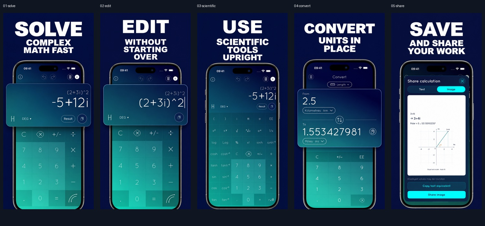

# ASO App Store Screenshots

Adam Lyttle's original screenshot workflow, with a small Codex execution layer and phase-based loading. This replaces the previous rewritten adaptation. Invoke `$aso-appstore-screenshots` from the app project.

Standalone distribution: [aruffolo/codex-skill-aso-appstore-screenshots](https://github.com/aruffolo/codex-skill-aso-appstore-screenshots). The maintained source lives in [agents-scripts](https://github.com/aruffolo/agents-scripts/tree/main/skills/aso-appstore-screenshots); synchronize the complete package, including removals, when updating the standalone repository. Keep campaign examples outside the preserved `upstream/` snapshot.

The original owns benefit discovery, screenshot assessment and pairing, solid-colour art direction, typography, breakouts, three image variants, style references, and approval gates. Broad research runs in a fresh subagent. Optional OpenAI execution and current delivery requirements load only when relevant. Campaign state stays in the user's project.

## Package ownership

- `SKILL.md`: compact entry point and phase routing.
- `upstream/`: complete original tracked package at the revision in `UPSTREAM.json`. Only `SKILL.md` is renamed to `skill-source.md` to avoid duplicate skill discovery; its bytes are unchanged.
- `references/phases/`: exact contiguous slices of that source, including its original examples and historical platform assumptions. `UPSTREAM.json` records each inclusive line range and digest.
- `references/codex.md`: state and research ownership mappings.
- `references/execution.md`: lazily loaded paths/tools and inherited renderer limitations.
- `references/research.md`: bounded child-task contract.
- `references/openai.md`: optional provider mapping, preserving the original image-reference roles.
- `references/delivery.md`: current platform verification and final-output checks.

Only the Codex layer overrides platform assumptions; extracted source files are not independent rewritten instructions. Do not load the complete upstream source in ordinary use. The main agent retains creative judgment and approvals; research returns a small cited report.

## Execution and limits

Python 3, Pillow, and a working SF Pro Display Black font are needed by the original scripts. Run `upstream/compose.py` and `upstream/showcase.py` from the app project using their original arguments. Gemini image editing is the upstream default; select OpenAI through its separate reference or request scaffold-only output explicitly.

The preserved composer has one fixed 1290×2796 layout. Inspect scaffolds for text overlap and safe margins. Current upload slots need independent verification; an iPad campaign needs an explicit layout extension. No renderer patches or additional layouts are hidden in this rebuild.

## Campaign example

[A Complex Calc — October 2026](examples/acomplexcalc/README.md) documents an approved five-slide campaign, a raw-to-final comparison, and 50 verified exports across five locales and two sizes. It also records the actual generation resolution and the limits of headline-only localization.

## Refreshing upstream

Stage the new repository in `/tmp/`, record its full commit, and compare it with the pinned source. Replace the original package as one reviewed unit, preserving its license. Re-extract phase ranges without rewriting their text; update the ranges and SHA-256 digests in `UPSTREAM.json`. Verify every tracked source file against the staged repository and every phase against its recorded source slice. Review adapter mappings for assumptions the new original has changed.

Validation should cover YAML/skill metadata, local reference links, source and extraction fidelity, real synthetic scaffold/showcase rendering, and an independent resume/delegation scenario. No paid image generation is needed for these checks.

Original: [adamlyttleapps/claude-skill-aso-appstore-screenshots](https://github.com/adamlyttleapps/claude-skill-aso-appstore-screenshots), MIT; see [LICENSE](LICENSE). Preserve the original copyright and permission notice in redistributions.
