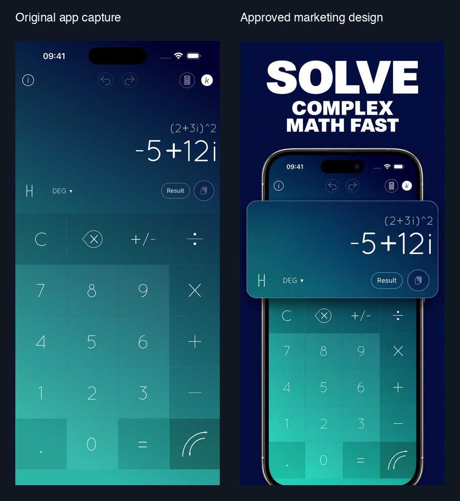

# A Complex Calc campaign

Approved on October 22, 2026. This example shows a completed screenshot campaign for A Complex Calc (AComplexCalc): five designs, five locales, and two portrait export sizes. The app captures use synthetic calculations, with no personal data.

## From capture to campaign

The opener pairs the benefit **SOLVE COMPLEX MATH FAST** with a real app capture of `(2+3i)^2 = -5+12i`. The approved design enlarges the complete expression/result panel, retaining the actual calculation and using a consistent navy background, heavy white headlines, and upright phone treatment.

The remaining slides demonstrate editing without starting over, scientific tools in portrait, in-place unit conversion, and saving/sharing calculations. Scientific and sharing screens retain their full relevant interface rather than forcing a panel breakout. The first approved design serves as the style reference for the set; these are the selected finals, not every explored variant.

## Delivery evidence

The approved campaign contains 50 PNGs: five slides × five locales (`en-US`, `en-GB`, `it`, `fr-FR`, `es-ES`) × two sizes (1206×2622 and 1320×2868). On October 23, all 50 source exports were checked against the campaign's recorded SHA-256 hashes and dimensions; every image was also checked as RGB without transparency. All checks passed. [evidence.json](evidence.json) records the export names, sizes, hashes, and check date. The JPEGs on this page are presentation previews, not upload assets.

Generation used `gpt-image-2` through the user's configured image proxy, with campaign-specific scaffolding and export/localization scripts kept in the app project. These scripts are separate from this package's preserved upstream renderer. The case study does not imply that the bundled composer natively produces these layouts, sizes, or translations.

The returned artwork was **852×1846**, despite a larger requested size. Approved delivery files use proportional top-centred upscaling; they are not native high-resolution generations. Italian, French, and Spanish marketing headlines were rendered at export resolution, while the phone and app imagery remained unchanged below the headline area. **The app UI remains English.**

This example demonstrates campaign output and asset verification. It makes no claim about measured conversion gains or current App Store publication status. Platform requirements must still be verified for each new campaign.
